# Chaos4CPS User Guide

## Table of Contents
1. [Introduction](#introduction)
2. [Getting Started](#getting-started)
3. [Chaos Engineering Workflow](#chaos-engineering-workflow)
4. [Step-by-Step Guide](#step-by-step-guide)
   - [Step 1: Login](#step-1-login)
   - [Step 2: Create Customer](#step-2-create-customer)
   - [Step 3: Define System Under Test (SUT)](#step-3-define-system-under-test-sut)
   - [Step 4: Create Version](#step-4-create-version)
   - [Step 5: Define Elements/Components](#step-5-define-elementscomponents)
   - [Step 6: Define Steady States](#step-6-define-steady-states)
   - [Step 7: Create Hypotheses](#step-7-create-hypotheses)
   - [Step 8: Design Experiments](#step-8-design-experiments)
   - [Step 9: Manage Scripts](#step-9-manage-scripts)
   - [Step 10: Manage Tools](#step-10-manage-tools)
   - [Step 11: Execute Experiments](#step-11-execute-experiments)
   - [Step 12: Document Recovery](#step-12-document-recovery)
   - [Step 13: Generate Reports](#step-13-generate-reports)
5. [Advanced Features](#advanced-features)
6. [Best Practices](#best-practices)

---

## Introduction

**Chaos4CPS** is a Chaos Engineering platform designed to help organizations test the resilience and robustness of their Cyber-Physical Systems (CPS). The platform follows chaos engineering principles to systematically inject controlled failures and observe system behavior.

### What is Chaos Engineering?

Chaos Engineering is the discipline of experimenting on a system to build confidence in its capability to withstand turbulent conditions in production. The process involves:

1. **Defining steady state** - Understanding normal system behavior
2. **Hypothesizing** - Predicting system behavior under specific conditions
3. **Running experiments** - Introducing controlled disruptions
4. **Observing and learning** - Analyzing results and improving system resilience

### Key Features

- **Hierarchical System Modeling** - Organize systems by customer, SUT, version, and components
- **Steady State Definition** - Define metrics that represent normal system behavior
- **Hypothesis Management** - Create and test hypotheses about system resilience
- **Experiment Tracking** - Design, execute, and track chaos experiments
- **Script Library** - Reusable scripts for injecting failures and monitoring systems
- **Recovery Documentation** - Track recovery procedures and outcomes
- **Report Generation** - Generate comprehensive reports of experiments and findings
- **AI Agent Support (CEAgent)** - AI-powered assistance for defining components, steady states, hypotheses, and experiments

---

## Getting Started

### Prerequisites

- Access to Chaos4CPS application (URL provided by your administrator)
- User account credentials (username and password)
- Understanding of your system architecture and components

### First Login

1. Navigate to the Chaos4CPS URL
2. Enter your credentials on the login page
3. You will be directed to the main admin dashboard


---

## Chaos Engineering Workflow

The Chaos4CPS platform follows a structured workflow for chaos engineering:

```
Customer → SUT → Version → Elements → Steady States
                              ↓
                         Hypotheses
                              ↓
                         Experiments
                              ↓
                         Executions → Observations
                              ↓
                      Recovery & Evaluation
                              ↓
                           Reports
```

**Important**: Follow this workflow sequentially, as each step depends on the previous ones.

---

## Step-by-Step Guide

### Step 1: Login

**Purpose**: Access the Chaos4CPS platform

**How to**:
1. Navigate to your Chaos4CPS instance URL
2. Enter your username and password
3. Click "Log in"

**What's Next**: After successful login, you'll see the main dashboard with various sections for managing chaos engineering activities.

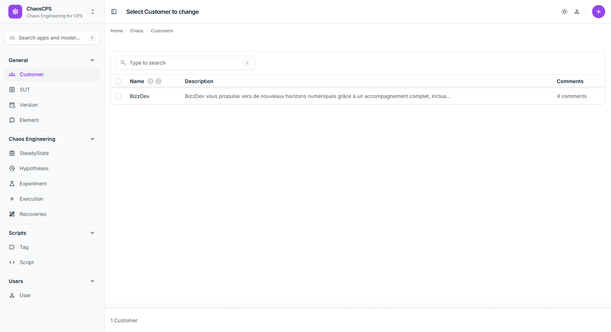

---

### Step 2: Create Customer

**Purpose**: Define the organization or client whose systems will be tested

**Navigation**: Main Dashboard → Customers → Add Customer

**Form Fields**:

#### Basic Information
- **Name** (required): Unique name for the customer (e.g., "ACME Corporation")
- **Description** (optional): Additional details about the customer

**Actions**:
1. Click "Customers" from the main menu
2. Click "Add Customer" button
3. Fill in the customer name
4. Add a description (optional but recommended)
5. Click "Save"

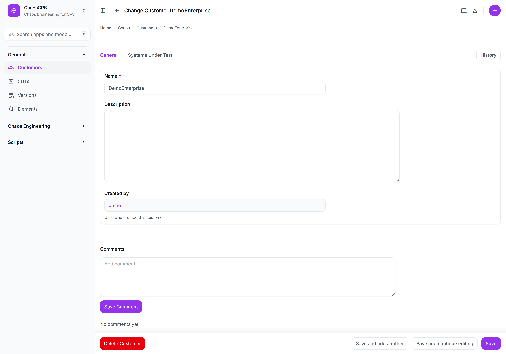

**Tips**:
- Use clear, recognizable names
- Include relevant details in the description to provide context
- You can have multiple customers in the system

**What's Next**: Create a System Under Test (SUT) for this customer

---

### Step 3: Define System Under Test (SUT)

**Purpose**: Define a specific system or application that will undergo chaos testing

**Navigation**: Main Dashboard → Systems Under Test → Add System Under Test

**Form Fields**:

#### Basic Information
- **Customer** (required): Select the customer who owns this system
- **Name** (required): Name of the system (e.g., "Payment Processing System")
- **Description** (optional): Detailed description of the system's purpose and architecture

**Actions**:
1. Click "Systems Under Test" from the main menu
2. Click "Add System Under Test"
3. Select the customer from the dropdown
4. Enter the system name
5. Provide a detailed description
6. Click "Save"

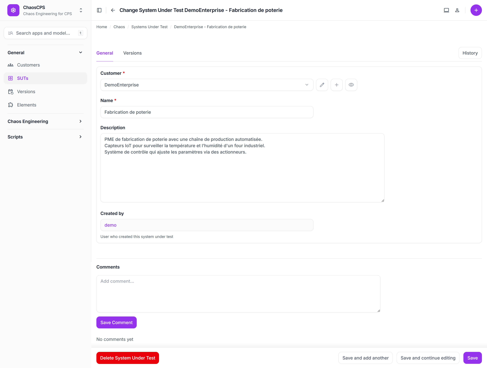

**Tips**:
- Be specific in your system naming
- Include architecture overview in the description
- Multiple SUTs can belong to the same customer

**What's Next**: Create one or more versions of this SUT

---

### Step 4: Create Version

**Purpose**: Define specific versions of your system for targeted testing

**Navigation**: Main Dashboard → Versions → Add Version

**Form Fields**:

#### Basic Information Tab
- **Customer** (required): Select the customer (filters available SUTs)
- **SUT** (required): Select the System Under Test
- **Name** (required): Version identifier (e.g., "v1.0", "Production-2024")
- **Description** (optional): What's specific to this version
- **Notes/Additional Information** (optional): Extra context useful for AI agent
- **Architecture** (optional): Upload architecture diagram (PDF, PNG, JPG, JPEG, SVG)

#### System Information Tab
- **UUID**: Automatically generated unique identifier
- **Created At**: Timestamp of creation
- **Updated At**: Last modification timestamp

**Actions**:
1. Click "Versions" from the main menu
2. Click "Add Version"
3. Select Customer (this will filter the SUT dropdown)
4. Select the SUT
5. Enter version name
6. Provide description and notes
7. Upload architecture diagram if available
8. Click "Save"

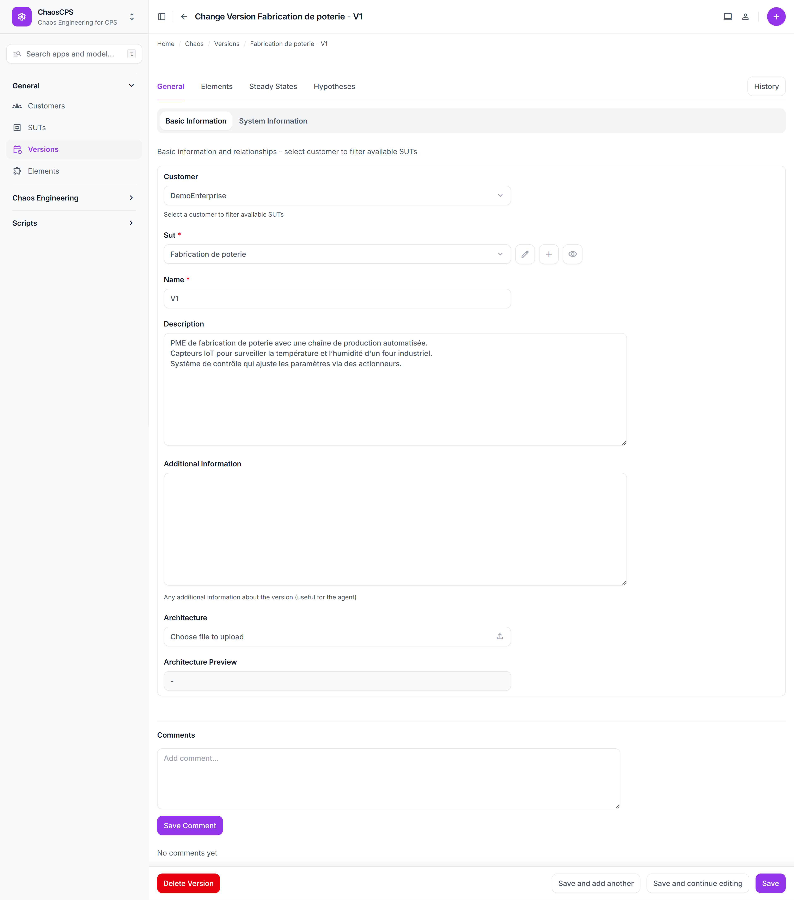

**Tips**:
- Version names should be clear and follow your organization's naming convention
- Architecture diagrams are highly valuable for understanding system structure
- Notes field is particularly useful when using the CEAgent AI assistant
- Use the customer selection to filter SUTs dynamically

**Special Features**:
- **Generate Report**: From the version list view, you can access a menu to generate reports for a specific version

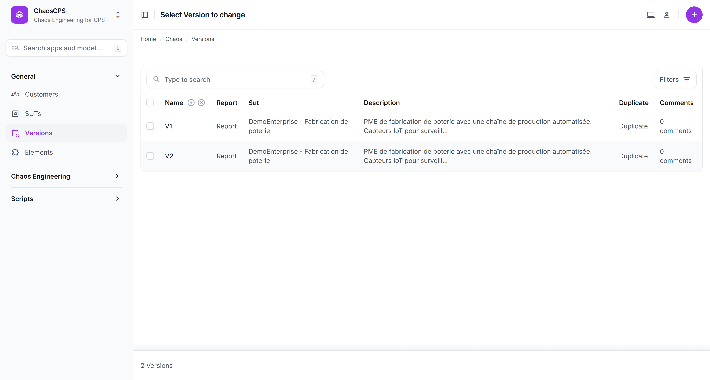

**What's Next**: Define elements/components that make up this version

---

### Step 5: Define Elements/Components

**Purpose**: Break down your system version into individual components or elements

**Navigation**: Main Dashboard → Elements → Add Element

**Form Fields**:

#### Basic Information Tab
- **Customer** (required): Select customer (filters SUTs and versions)
- **SUT** (required): Select the system
- **Version** (required): Select the version
- **Parent Element** (optional): Select a parent if this is a sub-component
- **Name** (required): Component name (e.g., "API Gateway", "Database Server")
- **Description** (optional): Detailed description of the component
- **Justification (from Agent)** (optional): AI-generated justification for this element
- **Dependencies** (optional): Dependencies on other elements
- **Image** (optional): Upload component diagram (PNG, JPG, JPEG, SVG)

**Actions**:
1. Click "Elements" from the main menu
2. Click "Add Element"
3. Select Customer, SUT, and Version (each selection filters the next)
4. Enter component name
5. (Optional) Select a parent element if this is a sub-component
6. Describe the component and its dependencies
7. Upload an image if available
8. Click "Save"

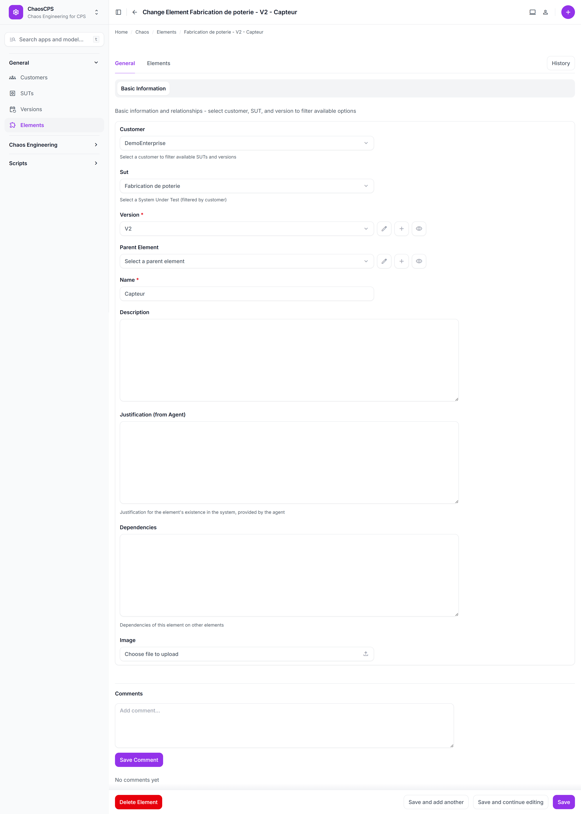

**Tips**:
- Create a hierarchical structure using parent-child relationships
- Be thorough in documenting dependencies
- Images help visualize component structure
- The justification field is automatically populated when using CEAgent

**Hierarchical Structure**:
Elements can be nested to represent system architecture:
```
System
├── Frontend Layer
│   ├── Web UI
│   └── Mobile App
├── Backend Layer
│   ├── API Gateway
│   ├── Authentication Service
│   └── Business Logic
└── Data Layer
    ├── Primary Database
    └── Cache Server
```

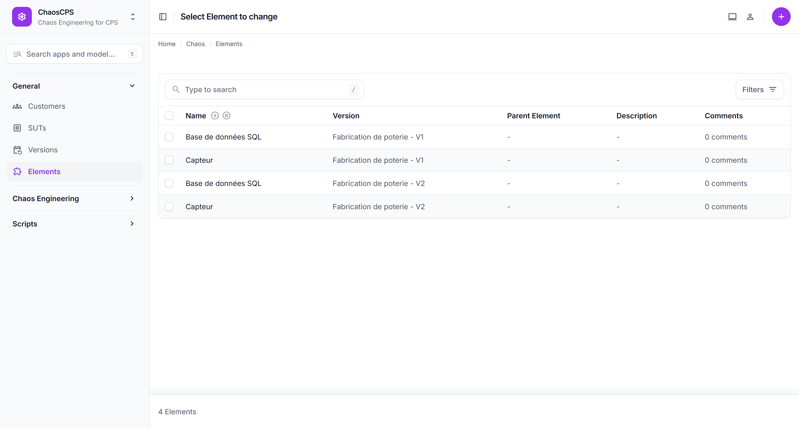

**What's Next**: Define steady states that indicate normal system behavior

---

### Step 6: Define Steady States

**Purpose**: Establish metrics and indicators that represent normal, healthy system behavior

**Navigation**: Main Dashboard → Steady States → Add Steady State

**Form Fields**:

#### Basic Information Tab
- **Customer** (required): Select customer
- **SUT** (required): Select system
- **Version** (required): Select version
- **Metric Name** (required): Name of the metric (e.g., "API Response Time", "Database Connection Pool")
- **Category** (optional): Category of the metric (e.g., "Performance", "Availability")
- **Normal Behavior Description** (required): Detailed description of what constitutes normal behavior for this metric
- **Deviation Indicators** (optional): What indicates deviation from normal
- **Justification (from Agent)** (optional): AI-generated explanation of why this metric is crucial

#### Script Configuration Tab
- **Script** (optional): Select a script to monitor or validate this steady state
  - When selected, you can configure script parameters

**Actions**:
1. Click "Steady States" from the main menu
2. Click "Add Steady State"
3. Select Customer, SUT, and Version
4. Enter the metric name
5. Describe normal behavior in detail
6. Specify deviation indicators
7. (Optional) Associate a monitoring script
8. (Optional) Configure script parameters if a script is selected
9. Click "Save"

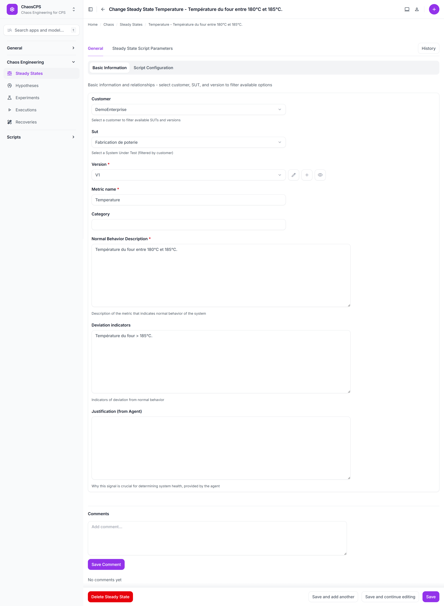

**Examples of Steady States**:

| Metric Name | Normal Behavior | Deviation Indicators |
|-------------|-----------------|---------------------|
| API Response Time | 95th percentile < 200ms | Response time > 500ms or timeout |
| Database Connections | Active connections 20-50 | Connections > 80 or all exhausted |
| CPU Usage | Average < 70% | CPU > 90% for 5+ minutes |
| Error Rate | < 0.1% of requests | Error rate > 1% |
| Service Availability | 100% uptime | Service unreachable |

**Tips**:
- Be specific and measurable in your descriptions
- Define clear thresholds
- Consider multiple aspects: performance, availability, reliability
- Use the category field to organize metrics
- Scripts can automate steady state monitoring

**What's Next**: Create hypotheses about how your system will behave under stress

---

### Step 7: Create Hypotheses

**Purpose**: Formulate testable predictions about system behavior under specific conditions

**Navigation**: Main Dashboard → Hypotheses → Add Hypothesis

**Form Fields**:

#### Basic Information Tab
- **Customer** (required): Select customer
- **SUT** (required): Select system
- **Version** (required): Select version
- **Name** (required): Hypothesis name (e.g., "Database Failure Resilience")
- **Description** (optional): Detailed hypothesis statement
- **Justification (from Agent)** (optional): AI explanation of why this hypothesis is relevant
- **Elements** (optional, multiple selection): Components involved in this hypothesis
- **Steady States** (optional, multiple selection): Metrics to monitor

**Actions**:
1. Click "Hypotheses" from the main menu
2. Click "Add Hypothesis"
3. Select Customer, SUT, and Version
4. Enter hypothesis name
5. Write a clear hypothesis description
6. Select relevant elements (components)
7. Select steady states to monitor
8. Click "Save"

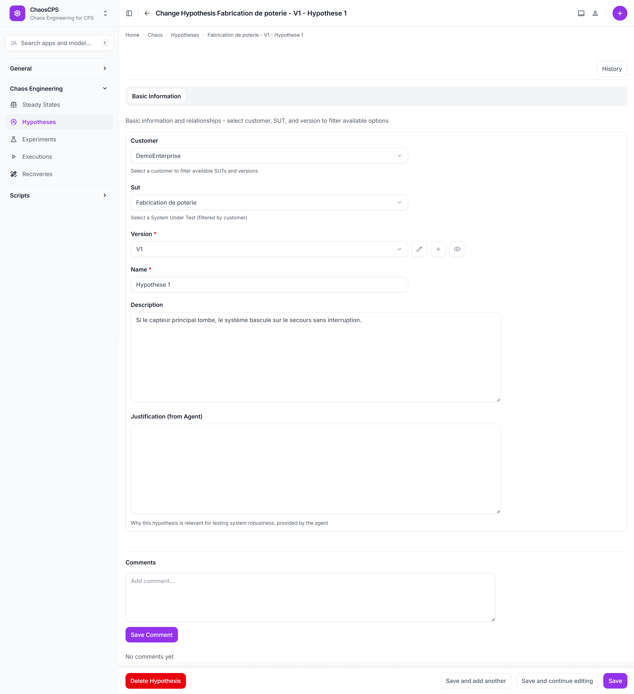

**Hypothesis Template**:
A good hypothesis follows this structure:
```
"If [specific condition/failure] occurs in [element/component],
then [specific steady state] will remain within acceptable bounds
because [reasoning]."
```

**Examples**:

1. **Database Failover Hypothesis**:
   - **Name**: "Primary Database Failure Resilience"
   - **Description**: "If the primary database fails, the system will automatically failover to the replica within 5 seconds, and API response times will remain below 500ms because we have automatic failover configured."
   - **Elements**: Primary Database, Replica Database, API Gateway
   - **Steady States**: API Response Time, Database Connections, Service Availability

2. **Network Latency Hypothesis**:
   - **Name**: "High Latency Tolerance"
   - **Description**: "If network latency between services increases to 200ms, the system will continue to function with degraded performance but no failures because of our timeout and retry policies."
   - **Elements**: API Gateway, Microservices
   - **Steady States**: API Response Time, Error Rate

**Tips**:
- Write testable, specific hypotheses
- Include expected outcomes
- Reference specific elements and steady states
- Document your reasoning
- Start with simpler hypotheses before complex ones

**What's Next**: Design experiments to test your hypotheses

---

### Step 8: Design Experiments

**Purpose**: Create detailed experiments to test hypotheses through controlled chaos

**Navigation**: Main Dashboard → Experiments → Add Experiment

**Form Fields**:

#### Basic Information Tab
- **Customer** (required): Select customer
- **SUT** (required): Select system
- **Version** (required): Select version
- **Hypothesis** (required): Select the hypothesis to test
- **Name** (required): Experiment name (e.g., "Database Failure Test")
- **Description** (optional): Detailed experiment procedure
- **Justification (from Agent)** (optional): AI explanation of experiment relevance

#### Relationships Tab
- **Elements** (multiple selection): Components involved in the experiment
- **Steady States** (multiple selection): Metrics to monitor during the experiment
- **Scripts** (multiple selection): Scripts to execute during the experiment

#### Script Configuration Tab
- **Script for Parameters**: Select a script to configure its parameters for this specific experiment

**Actions**:
1. Click "Experiments" from the main menu
2. Click "Add Experiment"
3. **Basic Information**:
   - Select Customer, SUT, Version
   - Select the Hypothesis you want to test
   - Enter experiment name
   - Describe the experimental procedure
4. **Relationships**:
   - Select elements that will be affected
   - Select steady states to monitor
   - Select scripts to execute
5. **Script Configuration**:
   - For each script, configure specific parameters
6. Click "Save"

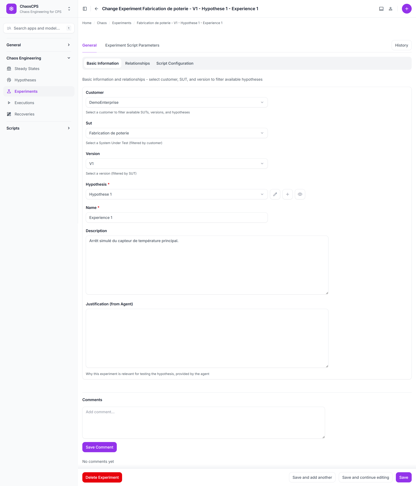

**Experiment Design Structure**:

```
Experiment: Primary Database Failure Test
├── Preparation
│   ├── Ensure monitoring is active
│   └── Verify backup systems are ready
├── Execution
│   ├── Run baseline measurement script
│   ├── Inject failure (stop database)
│   └── Monitor steady states
├── Observation
│   ├── Record API response times
│   ├── Monitor error rates
│   └── Check failover time
└── Recovery
    ├── Restore database
    └── Verify system returns to normal
```

**Tips**:
- Start with less critical systems
- Plan the experiment in detail before execution
- Always have a rollback plan
- Include monitoring scripts
- Document expected vs. actual behavior
- Select only relevant elements and steady states
- Configure script parameters carefully

**Script Parameter Configuration**:
When you select scripts, you can configure their parameters specifically for this experiment:
- Each script may have different parameters (string, integer, float, boolean, file)
- Parameters can be required or optional
- Configure parameters in the "Script Configuration" tab

**What's Next**: Before executing, ensure you have necessary scripts ready

---

### Step 9: Manage Scripts

**Purpose**: Create and manage reusable scripts for injecting failures, monitoring, and recovery

**Navigation**: Main Dashboard → Scripts → Add Script

**Form Fields**:

#### Basic Information Tab
- **Name** (required): Unique script name (e.g., "Stop Database Service")
- **Description** (optional): Purpose and usage instructions
- **Tags** (multiple selection): Categorize scripts (e.g., "failure-injection", "monitoring", "recovery")

#### Script Content Tab
- **Code** (optional): Inline script code
- **Script File** (optional): Upload script file (.py, .sh, .js, .rb, .pl)
- **Git Repository Link** (optional): Link to script repository

**Note**: At least one of Code, Script File, or Git Link must be provided.

**Actions**:
1. Click "Scripts" from the main menu
2. Click "Add Script"
3. Enter script name
4. Provide description explaining what the script does
5. Add relevant tags
6. Choose one of the following:
   - **Inline Code**: Paste the script code directly
   - **Script File**: Upload a script file
   - **Git Link**: Provide a link to a Git repository
7. Click "Save"
8. (Optional) Add Parameters by clicking on the script and adding Parameter objects

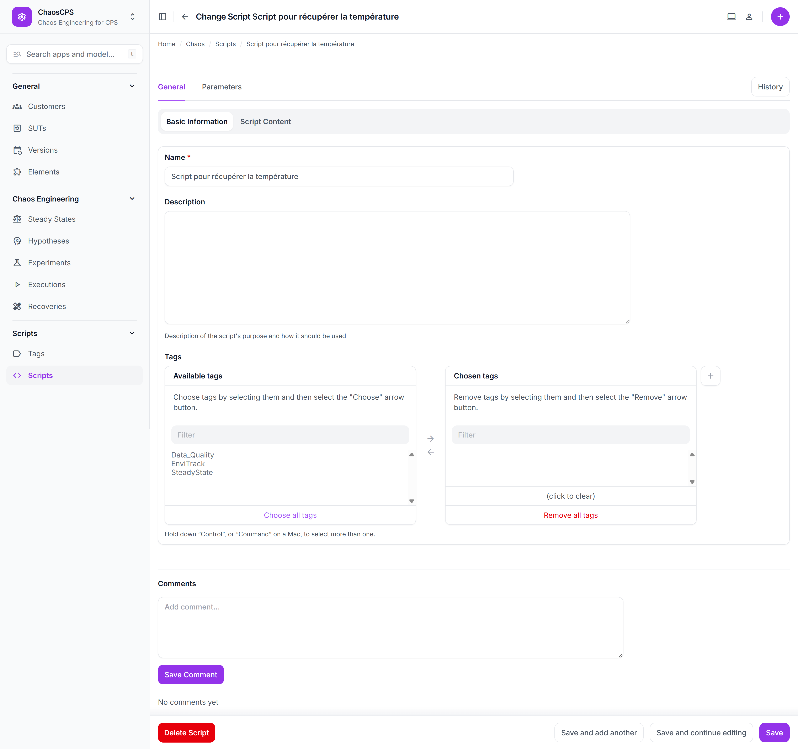

**Script Categories**:

1. **Failure Injection Scripts**:
   - Stop/kill services
   - Inject network latency
   - Fill disk space
   - Corrupt data
   - Simulate high CPU/memory usage

2. **Monitoring Scripts**:
   - Check service health
   - Measure response times
   - Monitor resource usage
   - Verify steady states

3. **Recovery Scripts**:
   - Restart services
   - Clear caches
   - Restore from backup
   - Reset configurations

**Script Parameters**:

After creating a script, you can add parameters to make it reusable:

**Navigation**: Scripts → [Your Script] → Parameters → Add Parameter

**Parameter Fields**:
- **Name** (required): Parameter name (e.g., "service_name", "timeout")
- **Description** (optional): What this parameter controls
- **Parameter Type**: string, integer, float, boolean, or file
- **Default Value** (optional): Default value if not specified
- **Required**: Whether this parameter must be provided

**Example Script with Parameters**:

```
Script: Stop Docker Container
Description: Stops a specified Docker container

Parameters:
- container_name (string, required): Name of the container to stop
- force (boolean, optional, default: false): Force stop without graceful shutdown
- timeout (integer, optional, default: 10): Seconds to wait before force stop
```

**Tips**:
- Keep scripts focused on single tasks
- Use descriptive names
- Include error handling in scripts
- Test scripts in safe environments first
- Use tags to organize your script library
- Document prerequisites and dependencies
- Version control scripts using Git integration
- Make scripts parameterized for reusability

**What's Next**: Execute your experiments using these scripts

---

### Step 10: Manage Tools

**Purpose**: Create and manage tools that can be used alongside scripts in your chaos engineering workflow (e.g., utilities, analyzers, or external tooling).

**Navigation**: Main Dashboard → Scripts & Tools → Tools → Add Tool (or change an existing tool from the Tools list)

**Form Fields**:

#### Basic Information Tab
- **Name** (required): Unique name for the tool (e.g., "Tool demo 1")
- **Description** (optional): Description of the tool's purpose and how it should be used. Use the text area to provide clear usage instructions.
- **Tags** (multiple selection): Categorize the tool for easier discovery.
  - **Available tags**: List of tags you can assign. Use the "Filter" field to search, select one or more tags (hold **Control** or **Command** on Mac for multiple selection), then click the **Choose** arrow to add them to the tool.
  - **Chosen tags**: Tags currently assigned to the tool. Select tags and click the **Remove** arrow to unassign them. Use "Choose all tags" / "Remove all tags" to bulk assign or clear.
- **Shared**: Toggle to make the tool visible and usable by other users (when enabled).
- **Comments**: Add comments to document decisions or notes about the tool. Use "Add comment..." and click **Save Comment**. Existing comments are listed below.

#### Tool Content Tab
- Use this tab to define or upload the actual content or configuration of the tool (e.g., code, configuration, or references).

**Actions**:
1. Go to **Scripts & Tools** in the left menu, then **Tools**.
2. Click **Add Tool** to create a new tool, or click an existing tool name to edit it.
3. On the **Basic Information** tab:
   - Enter the tool **Name** (required).
   - Optionally fill in the **Description** with purpose and usage.
   - Assign **Tags** by moving them from "Available tags" to "Chosen tags".
   - Set **Shared** if the tool should be available to others.
   - Add **Comments** if needed.
4. Switch to the **Tool Content** tab to define or upload the tool content.
5. Save using one of:
   - **Save** – Save and return to the list or previous view.
   - **Save and continue editing** – Save and stay on the form.
   - **Save and add another** – Save and open a new blank tool form.
6. To remove a tool, use the **Delete Tool** button (red) at the bottom of the form.

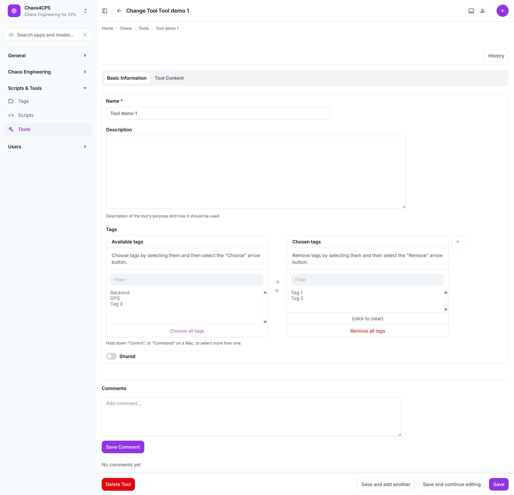

**Tips**:
- Use a clear, descriptive name and description so others understand the tool’s role.
- Use tags consistently (e.g., by type or environment) to make tools easy to find.
- Use comments to record why a tool was added or how it should be used in experiments.

**What's Next**: Use your scripts and tools when executing experiments

---

### Step 11: Execute Experiments

**Purpose**: Run chaos experiments and record observations

**Navigation**: Main Dashboard → Executions → Add Execution

**Form Fields**:

#### Basic Information Tab
- **Customer** (required): Select customer
- **SUT** (required): Select system
- **Version** (required): Select version
- **Hypothesis** (required): Select hypothesis
- **Experiment** (required): Select experiment to execute
- **Status**: "Not Completed" or "Completed"
- **Execution Date** (auto): When the execution is scheduled/occurred

#### Execution Details Tab
- **Started At**: When execution began
- **Completed At**: When execution finished
- **Log**: Upload execution log file
- **Log Preview**: View uploaded log content
- **Error Message**: Any errors encountered

#### Script Configuration Tab
- **Script**: View scripts configured for the experiment

**Actions**:

**Before Execution**:
1. Review experiment design
2. Verify monitoring is in place
3. Inform relevant stakeholders
4. Prepare rollback procedures

**During Execution**:
1. Click "Executions" from the main menu
2. Click "Add Execution"
3. Select Customer, SUT, Version, Hypothesis, and Experiment
4. Set execution date/time
5. Click "Save" to create the execution record
6. Record "Started At" time
7. Run the experiment according to the designed procedure
8. Monitor steady states and record observations
9. Collect logs

**After Execution**:
1. Record "Completed At" time
2. Update status to "Completed"
3. Upload execution logs
4. Document any errors in "Error Message"
5. Click "Save"
6. Add Observations (see below)

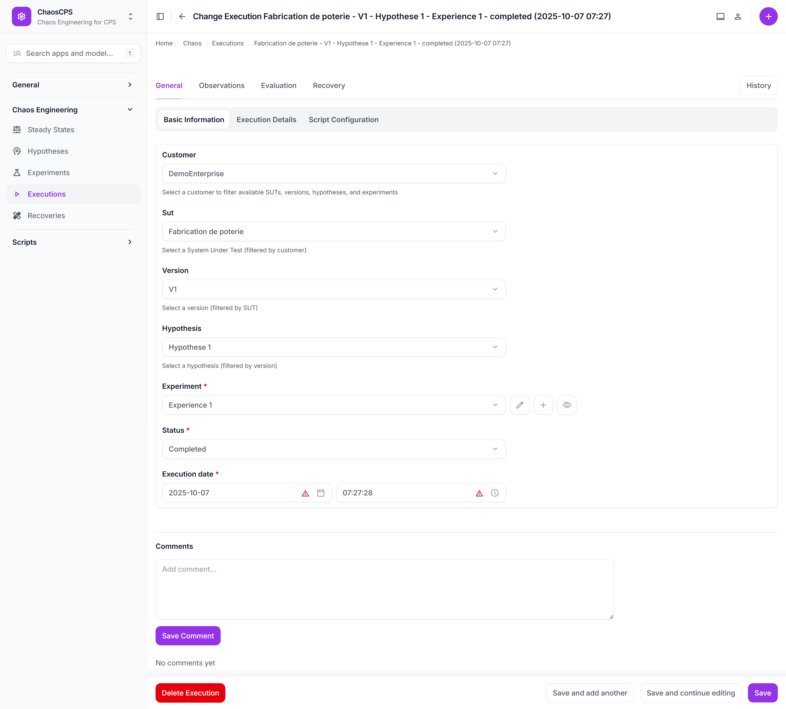

**Adding Observations**:

Observations record the actual values of steady states during execution.

**Navigation**: Executions → [Your Execution] → Observations → Add Observation

**Observation Fields**:
- **Execution** (auto): Linked to current execution
- **Steady State** (required): Which metric was observed
- **Observed Value** (required): The actual measured value
- **Observation Date** (auto): When the observation was recorded

**Example Observations**:

| Steady State | Normal Behavior | Observed Value | Status |
|--------------|-----------------|----------------|---------|
| API Response Time | < 200ms | 450ms | ⚠️ Degraded |
| Error Rate | < 0.1% | 0.05% | ✅ Normal |
| Service Availability | 100% | 100% | ✅ Normal |
| Database Connections | 20-50 | 85 | ❌ Exceeded |

**Tips**:
- Execute during low-traffic periods when possible
- Have multiple team members monitor
- Record observations in real-time
- Document unexpected behaviors
- Keep detailed logs
- Be prepared to abort if critical issues arise
- Calculate execution duration automatically from start/end times

**What's Next**: Document the recovery process

---

### Step 12: Document Recovery

**Purpose**: Record how the system recovered (or was recovered) after the experiment

**Navigation**: Main Dashboard → Recoveries → Add Recovery

**Form Fields**:

#### Basic Information Tab
- **Customer** (required): Select customer
- **SUT** (required): Select system
- **Version** (required): Select version
- **Hypothesis** (required): Select hypothesis
- **Experiment** (required): Select experiment
- **Execution** (required): Select the specific execution
- **Name** (required): Recovery process name (e.g., "Manual Database Restart")
- **Outcome**: "Pass" or "Fail"

#### Recovery Details Tab
- **Recovery Process** (optional): Detailed steps taken to recover
- **Notes** (optional): Additional observations
- **Recovery Date** (auto): When recovery was performed

#### Script Configuration Tab
- **Script**: Select and configure scripts used for recovery

**Actions**:
1. Click "Recoveries" from the main menu
2. Click "Add Recovery"
3. Select Customer, SUT, Version, Hypothesis, Experiment, and Execution
4. Enter a name for the recovery process
5. Document the recovery process in detail:
   - What steps were taken?
   - What tools/scripts were used?
   - How long did it take?
   - Were there any challenges?
6. Set the outcome (Pass/Fail)
7. Add any additional notes
8. (Optional) Configure recovery scripts used
9. Click "Save"

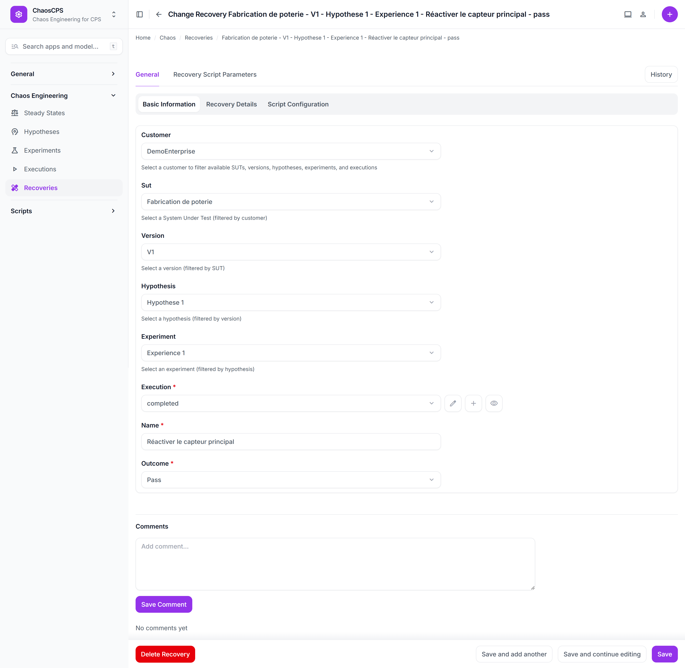

**Recovery Process Documentation Template**:

```
Recovery Name: Database Restart and Failback

Steps Taken:
1. Verified replica database was handling traffic successfully
2. Identified root cause of primary database failure (disk space)
3. Cleared unnecessary logs and freed disk space
4. Restarted primary database service
5. Verified primary database health checks
6. Switched traffic back to primary database
7. Confirmed all metrics returned to normal

Duration: 15 minutes
Manual Intervention Required: Yes
Outcome: Pass

Notes:
- Replica handled load well during failover
- Need automated disk space monitoring
- Consider increasing disk space
```

**Recovery Script Configuration**:
- Select scripts that were used in recovery
- Configure script parameters
- Document whether recovery was automated or manual

**Recovery Outcomes**:
- **Pass**: System fully recovered to steady state
- **Fail**: System did not recover as expected

**Tips**:
- Document recovery steps immediately while fresh
- Be honest about manual interventions required
- Note recovery time precisely
- Identify opportunities for automation
- Record any workarounds used
- List all scripts/tools used
- Recommend improvements

**What's Next**: Evaluate the execution results

---

### Step 13: Generate Reports

**Purpose**: Create comprehensive reports of experiments and findings

**Navigation**: Multiple access points

**Report Access Methods**:

1. **From Version List View**:
   - Navigate to Versions
   - Find the version you want to report on
   - Click the action menu (three dots or gear icon)
   - Select "Generate Report"

2. **From Version Detail Page**:
   - Open a specific version
   - Look for "Generate Report" button or link


**Report Contents**:

A Chaos4CPS report typically includes:

1. **Executive Summary**:
   - System overview
   - Testing period
   - Key findings

2. **System Architecture**:
   - Customer and SUT information
   - Version details
   - Architecture diagram
   - Elements/components list

3. **Steady States**:
   - Defined metrics
   - Normal behavior baselines
   - Deviation indicators

4. **Hypotheses**:
   - Hypothesis statements
   - Associated elements and steady states
   - Justifications

5. **Experiments**:
   - Experiment designs
   - Associated scripts
   - Parameter configurations

6. **Executions**:
   - Execution details
   - Observations
   - Duration and timing
   - Logs and errors

7. **Evaluations**:
   - Pass/Fail status
   - Notes and recommendations
   - Analysis

8. **Recovery Processes**:
   - Recovery procedures
   - Outcomes
   - Lessons learned

9. **Recommendations**:
   - System improvements
   - Future experiments
   - Process enhancements

**Report Formats**:
- PDF (standard format)
- HTML (web viewing)
- Other formats may be available

**Tips**:
- Generate reports after completing execution cycles
- Include all relevant experiments in one reporting period
- Review reports with your team
- Use reports for stakeholder communication
- Archive reports for compliance and auditing
- Compare reports over time to track improvements

**What's Next**: Use insights to improve system resilience and plan next experiments

---

## Advanced Features

### 1. AI Agent (CEAgent)

Chaos4CPS includes an AI agent called **CEAgent** that assists SMEs (Subject Matter Experts) in defining:
- Components/Elements
- Steady States
- Hypotheses
- Experiments

**How to Use CEAgent**:
1. Provide system information and architecture
2. The agent analyzes your system
3. It suggests components, steady states, hypotheses, and experiments
4. Review and edit suggestions
5. Import into Chaos4CPS


**Benefits**:
- Faster setup for new systems
- Best practice recommendations
- Comprehensive coverage
- Expert knowledge encoded

### 2. Dynamic Filtering

The Chaos4CPS interface uses dynamic filtering to streamline data entry:

**How It Works**:
- When you select a **Customer**, the SUT dropdown shows only that customer's systems
- When you select a **SUT**, the Version dropdown shows only that SUT's versions
- When you select a **Version**, Elements, Steady States, and Hypotheses are filtered accordingly

**Benefits**:
- Prevents errors
- Faster data entry
- Better user experience
- Maintains data integrity

### 3. Script Parameter Management

Scripts can be parameterized for reusability:

**Three Parameter Types**:
1. **Steady State Script Parameters**: Configure scripts for monitoring steady states
2. **Experiment Script Parameters**: Configure scripts for experiment execution
3. **Recovery Script Parameters**: Configure scripts for recovery processes

**Parameter Validation**:
- The system ensures parameters belong to the selected script
- Required parameters must be provided
- Type checking prevents errors

### 4. Hierarchical Elements

Elements can be organized hierarchically:

**Use Cases**:
- Model complex system architectures
- Represent containment relationships
- Group related components
- Navigate system structure

**Example**:
```
E-commerce Platform
├── Frontend
│   ├── Web Application
│   └── Mobile App
├── Backend
│   ├── API Gateway
│   ├── Order Service
│   ├── Payment Service
│   └── Inventory Service
└── Infrastructure
    ├── Database Cluster
    ├── Cache Layer
    └── Message Queue
```

### 5. Comments System

All major entities support comments for collaboration:

**Where Available**:
- Customers
- SUTs
- Versions
- Elements
- Steady States
- Hypotheses
- Experiments
- Scripts & Tools
- Executions
- Recoveries

**Use Comments For**:
- Discussion and collaboration
- Clarification requests
- Decision documentation
- Knowledge sharing

### 6. Tagging System

Tags help organize and categorize scripts:

**Common Tag Categories**:
- **By Function**: monitoring, failure-injection, recovery, validation
- **By Technology**: docker, kubernetes, network, database
- **By Impact**: high-risk, low-risk, safe
- **By Environment**: production-safe, test-only

**Benefits**:
- Quick script discovery
- Better organization
- Team collaboration
- Reusability

---

## Best Practices

### 1. Planning and Preparation

✅ **Do**:
- Start with thorough system documentation
- Involve multiple team members
- Begin with non-critical systems
- Have clear rollback procedures
- Set up proper monitoring before experiments

❌ **Don't**:
- Rush into experiments without planning
- Test in production without safeguards
- Skip the hypothesis formation phase
- Forget to document expected behavior

### 2. Defining Steady States

✅ **Do**:
- Use measurable, quantitative metrics
- Define clear thresholds
- Consider multiple dimensions (performance, availability, consistency)
- Include both system and business metrics
- Validate steady states before experimentation

❌ **Don't**:
- Use vague or subjective metrics
- Define only one steady state
- Skip baseline measurements
- Ignore business impact metrics

### 3. Hypothesis Formation

✅ **Do**:
- Make hypotheses specific and testable
- Base hypotheses on real concerns
- Include expected outcomes
- Document assumptions
- Start with simpler hypotheses

❌ **Don't**:
- Create vague hypotheses
- Test multiple variables at once
- Skip justification
- Make untestable predictions

### 4. Experiment Design

✅ **Do**:
- Design experiments with clear steps
- Include safety mechanisms (circuit breakers)
- Plan for the smallest possible blast radius
- Have abort criteria defined
- Test in lower environments first

❌ **Don't**:
- Create overly complex experiments
- Test without monitoring
- Affect the entire system at once
- Proceed if abort criteria are met

### 5. Execution

✅ **Do**:
- Execute during low-traffic periods initially
- Have multiple observers
- Record everything
- Follow the experiment plan
- Be ready to stop immediately if needed

❌ **Don't**:
- Execute during peak hours initially
- Run unsupervised
- Deviate from the plan without documentation
- Continue if safety limits are exceeded

### 6. Documentation

✅ **Do**:
- Document in real-time
- Be thorough and honest
- Include unexpected observations
- Record timings precisely
- Document recovery procedures

❌ **Don't**:
- Rely on memory for documentation
- Omit failures or problems
- Skip details
- Forget to document recovery

### 7. Continuous Improvement

✅ **Do**:
- Review results with the team
- Identify system improvements
- Automate when possible
- Share learnings across teams
- Run experiments regularly

❌ **Don't**:
- Treat chaos engineering as one-time activity
- Skip post-experiment analysis
- Ignore discovered issues
- Keep findings siloed

### 8. Safety and Ethics

✅ **Do**:
- Get proper approvals
- Communicate with stakeholders
- Have rollback plans ready
- Respect system boundaries
- Consider customer impact

❌ **Don't**:
- Run unauthorized experiments
- Hide experiment activities
- Risk data loss or corruption
- Ignore compliance requirements

---

## Troubleshooting

### Common Issues and Solutions

**Issue**: Cannot save element/hypothesis/experiment
- **Cause**: Selected customer/SUT/version combination is invalid
- **Solution**: Verify the hierarchy - check that the SUT belongs to the customer, and version belongs to the SUT

**Issue**: Script parameters not appearing
- **Cause**: Parameters not defined for the script
- **Solution**: Go to Scripts → [Your Script] → Parameters and add parameter definitions

**Issue**: Cannot generate report
- **Cause**: Missing required data for the version
- **Solution**: Ensure version has at least one completed execution with observations

**Issue**: Dynamic filtering not working
- **Cause**: JavaScript not loaded properly
- **Solution**: Refresh the page or clear browser cache

---

## Support and Resources

### Getting Help

- **Documentation**: This user guide and README.md
- **AI Assistant**: Use CEAgent for guidance on setting up experiments
- **Admin Dashboard**: Built-in help text on form fields
- **Team**: Consult with your team members who have experience with chaos engineering

---

## Glossary

- **Chaos Engineering**: The discipline of experimenting on a system to build confidence in its capability to withstand turbulent conditions
- **Customer**: An organization or client whose systems are being tested
- **SUT (System Under Test)**: A specific system or application undergoing chaos testing
- **Version**: A specific version or configuration of a SUT
- **Element/Component**: Individual parts or services that make up a system
- **Steady State**: Measurable output of a system that indicates normal behavior
- **Hypothesis**: A testable prediction about system behavior under specific conditions
- **Experiment**: A controlled test designed to validate a hypothesis
- **Execution**: A single run of an experiment
- **Observation**: Recorded metric values during an experiment execution
- **Recovery**: The process of returning a system to normal state after an experiment
- **Evaluation**: Assessment of whether an experiment execution passed or failed
- **Blast Radius**: The scope of impact of a chaos experiment
- **Script**: Automated code for failure injection, monitoring, or recovery

---

## Appendix: Workflow Checklist

Use this checklist when conducting chaos engineering with Chaos4CPS:

### Pre-Experiment Phase
- [ ] Customer created
- [ ] SUT defined
- [ ] Version created with architecture
- [ ] All elements/components documented
- [ ] Steady states defined and validated
- [ ] Hypotheses formulated
- [ ] Experiments designed
- [ ] Scripts created and tested
- [ ] Monitoring in place
- [ ] Stakeholders informed
- [ ] Rollback procedures prepared
- [ ] Team briefed

### Experiment Phase
- [ ] Execution record created
- [ ] Start time recorded
- [ ] Experiment procedure followed
- [ ] Observations recorded in real-time
- [ ] Logs collected
- [ ] Unexpected behaviors documented
- [ ] End time recorded
- [ ] Status updated

### Post-Experiment Phase
- [ ] Recovery process documented
- [ ] Recovery outcome recorded
- [ ] Evaluation completed
- [ ] Notes and recommendations added
- [ ] Report generated
- [ ] Findings shared with team
- [ ] System improvements identified
- [ ] Follow-up experiments planned

---

**Document Version**: 2.0  
**Last Updated**: February 2026  
**System**: Chaos4CPS - Chaos Engineering Platform for Cyber-Physical Systems

